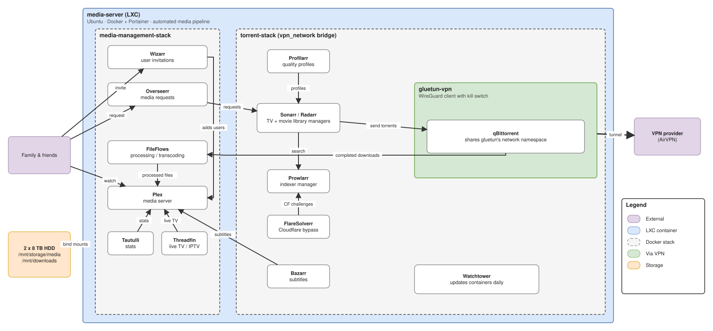

# Media server (LXC `media-server`)

Ubuntu LXC with Docker and Portainer. Everything is split into two compose stacks.

## Pipeline

In short: Overseerr requests go to Sonarr/Radarr, which search via Prowlarr and send torrents to qBittorrent (inside the gluetun VPN). Completed downloads are processed by FileFlows and served by Plex.

Watchtower updates containers on a schedule (default: daily at midnight).

## Stacks

### `torrent-stack.yaml`: acquisition

| Container | Role | Port |
|---|---|---|
| gluetun-vpn | WireGuard VPN client (AirVPN); network for qBittorrent | 8080 (qBit UI), 57623 |
| qbittorrent | Downloader, uses gluetun's network namespace | via gluetun |
| prowlarr | Indexer manager | 9696 |
| flaresolverr | Cloudflare challenge solver | 8191 |
| sonarr | TV management | 8989 |
| radarr | Movie management | 7878 |
| bazarr | Subtitles | 6767 |
| profilarr | Quality profile sync | 6868 |
| watchtower | Auto-updates | - |

### `media-management-stack.yaml`: serving

| Container | Role | Port |
|---|---|---|
| plex | Media server (host network, `/dev/dri` transcoding) | 32400 |
| overseerr | Media requests | 5055 |
| wizarr | User invitations | 5690 |
| tautulli | Plex statistics | 8181 |
| threadfin | IPTV/M3U proxy for Plex live TV | 34400 |
| fileflows | Automated file processing | 19200 |

## Configuration

All environment-specific values (IDs, timezone, paths, VPN credentials, schedules) live in the `.env.*` files, not the compose files. See the `.example` files.

| Variable | Meaning |
|---|---|
| `PUID` / `PGID` | User/group the containers run as |
| `TZ` | Timezone |
| `MEDIA_PATH` | Media library root (`/mnt/storage/media`, contains `tv/`, `movies/`) |
| `DOWNLOADS_PATH` | Download root (`/mnt/downloads`, uses `complete/tv`, `complete/movies`) |
| `VPN_*`, `SERVER_COUNTRIES`, `WIREGUARD_*` | gluetun VPN settings |
| `FIREWALL_VPN_INPUT_PORTS` | Ports allowed through the VPN firewall (forwarded port + qBit UI) |
| `WATCHTOWER_SCHEDULE` | Cron (with seconds) for update checks |

## Notes

- Sonarr, Radarr, Prowlarr, Bazarr, Profilarr and FlareSolverr share the `vpn_network` bridge with gluetun and reach qBittorrent at `gluetun-vpn:8080`.
- Hardware transcoding needs `/dev/dri` passed through to the LXC.
- Images use `latest`; Watchtower keeps them current.
